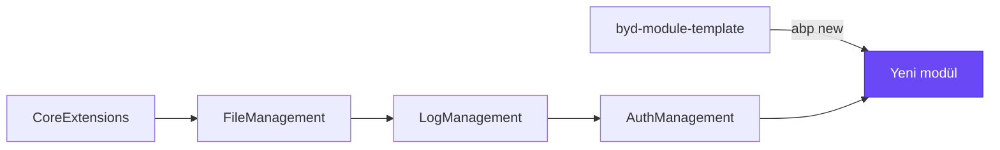
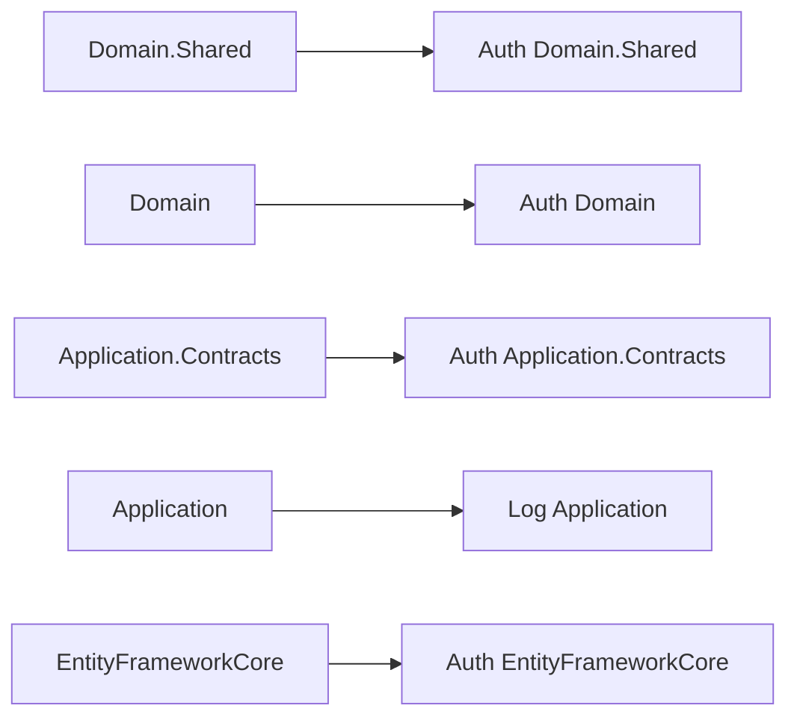

# Byd module template

Byd platformunda her yeni modül bu template'ten üretilir. Template platform paketlerinin bağlantısını, host'un yapısını,
schema kurallarını ve test projelerini hazır getirir; yeni modül boş bir ABP modülünden ya da başka bir modülün
kopyasından değil buradan başlar.

> Bu file template'le birlikte yeni modüle de kopyalanır. Üretilen modülde README'yi modülün kendi anlatımıyla değiştir.



## Capabilities

| Capability | Ne sağlar |
|---|---|
| Hazır platform bağlantısı | Her katman doğru platform paketini alır; core, file, log ve auth zincirden gelir |
| Hazır DbContext | Core'un `BydDbContext` base'i, snake_case isimlendirme, modül adından schema |
| Hazır host | JWT ile auth'a bağlı, multi-tenant, Türkçe ve İngilizce, Swagger, doğru middleware sırası |
| Dört environment | Development, Testing, Staging, Production profilleri tek port'ta |
| Permission iskeleti | Boş permission grubu, platformun partial file düzeninde |
| Test projeleri | Domain, Application ve EntityFrameworkCore testleri, ortak test base'i |

## Modül üretmek

```bash
abp new Byd.<Ad> -t module --no-ui --dbms PostgreSQL --separate-auth-server -v 10.3.0 -ts "https://github.com/mertbyd/byd-module-template/archive/refs/heads/predev.zip" --old
```

`Byd.<Ad>` modülün adıdır; repo klasörü `byd-<ad>-api` olur. CLI `MyCompanyName` ve `MyProjectName` placeholder'larını
path, isim ve içeriklerin hepsinde değiştirir. "Creating initial migrations process is failed" satırı beklenir; template
migration taşımaz.

## Katman başına platform paketi



`Application` katmanı auth'un Application paketini almaz; o paket token server'ı taşır.

## Üretimden sonra

1. Port'u diğer modüllerle karşılaştır, çakışıyorsa değiştir.
2. Çözümü derle: sıfır warning, sıfır error.
3. Host appsettings'lerini oluştur. `appsettings.json`, `.Testing`, `.Staging`, `.Production` commit edilir;
   `appsettings.Development.json` local'de kalır. Secret değerler `<injected-secret>` olarak yazılır.
4. `.gitignore` ekle.
5. Host'u ortak database'e karşı başlat: Swagger açılmalı, auth token'ıyla çağrı geçmeli, modülün permission'ları
   görünmeli.
6. README'yi modülün kendi anlatımıyla değiştir.

## Template'i değiştirmek

Template'teki her şey placeholder olarak kalır. Değişiklik bir `MTP-<no>` branch'inde yapılır ve `predev`'e merge edilir;
değiştirilmiş template'ten bir proje üretilip sıfır warning'le derlenerek doğrulanır.
