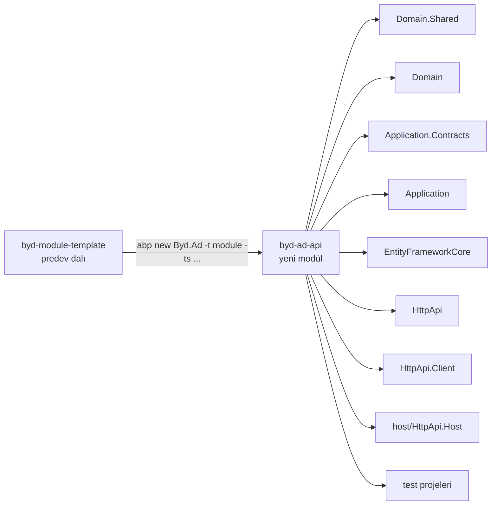
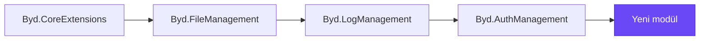

# Byd modül şablonu


Byd platformunda her yeni modül bu şablondan üretilir. Şablon platform paketlerinin bağlantısını, host'un biçimini, şema
kurallarını ve test projelerini hazır getirir; yeni modül boş bir ABP modülünden ya da başka bir modülün kopyasından
değil buradan başlar.

> Bu dosya şablonla birlikte yeni modüle de kopyalanır. Üretilen modülde README'yi modülün kendi anlatımıyla değiştir.

## İçindekiler

- [Ne üretir](#ne-üretir)
- [Modül üretmek](#modül-üretmek)
- [Şablonun getirdikleri](#şablonun-getirdikleri)
- [Üretimden sonra](#üretimden-sonra)
- [Şablonu değiştirmek](#şablonu-değiştirmek)

## Ne üretir



Yeni modül platform zincirinin en üstüne oturur: auth paketleri üzerinden log, file ve core'u da alır.



## Modül üretmek

```bash
abp new Byd.<Ad> -t module --no-ui --dbms PostgreSQL --separate-auth-server -v 10.3.0 -ts "https://github.com/mertbyd/byd-module-template/archive/refs/heads/predev.zip" --old
```

| Parça | Anlamı |
|---|---|
| `Byd.<Ad>` | Modülün adı; repo klasörü `byd-<ad>-api` olur |
| `-t module` | ABP modül şablon tipi |
| `-ts "<kaynak>"` | Şablon kaynağı; repo herkese açık olduğu için `predev` arşivi token istemez |
| `--old` | ABP Studio CLI'yi eski CLI'ya yönlendirir; global `abp` zaten eski `Volo.Abp.Cli` ise gerekmez |

Notlar:

- Yer tutucular `MyCompanyName` ve `MyProjectName`'dir; CLI yol, ad ve içeriklerdeki bütün biçimlerini (camelCase,
  kebab-case, küçük harf, BÜYÜK_YILAN) değiştirir.
- Eski CLI 10.3.0 adres kaynağını okuyamaz; 10.6.1 ve 7.3.2 okur.
- GitHub arşivi bir kök klasör taşır (`byd-module-template-predev/`); proje onun altına düşer.
- Çevrimdışı çalışmak için `git archive --format=zip -o t.zip origin/predev` ile yerel bir zip üretilip yerel bir HTTP
  sunucusundan `-ts` olarak verilebilir.
- Çıktı `has been successfully created` ile biter. "Creating initial migrations process is failed" ve "No project found in
  the directory" satırları beklenir: şablon migration ve arayüz taşımaz.

## Şablonun getirdikleri

| Alan | İçerik |
|---|---|
| Projeler | `Domain.Shared`, `Domain`, `Application.Contracts`, `Application`, `EntityFrameworkCore`, `HttpApi`, `HttpApi.Client`, `host/HttpApi.Host`, `host/Host.Shared`, `Domain.Tests`, `Application.Tests`, `EntityFrameworkCore.Tests`, `TestBase` |
| Platform paketleri | Her katman karşılık gelen platform katmanını alır (aşağıdaki tablo) |
| Şema | Şema adı modül adının snake_case hali; `<Modül>DbProperties` önek, şema ve bağlantı adını taşır |
| DbContext | Core'un `BydDbContext<T>` tabanı, snake_case adlandırma, tasarım zamanı fabrikası |
| Host | `AuthServer:Authority`'ye karşı JWT doğrulama, çok kiracılık açık, Türkçe ve İngilizce, Swagger (Production hariç) |
| Pipeline | Core, file, yetkilendirme ve audit ara katmanları belgelenmiş sırada |
| Başlatma | `launchSettings.json`: Development, Testing, Staging, Production profilleri tek bir `443xx` portta |
| İzinler | Boş izin grubu, platformun partial dosya düzeninde |
| Taşımadıkları | appsettings dosyaları, migration'lar, örnek entity'ler |

**Katman başına platform paketi**

| Modül katmanı | Platform paketi |
|---|---|
| `Domain.Shared` | `Byd.AuthManagement.Domain.Shared` |
| `Domain` | `Byd.AuthManagement.Domain` |
| `Application.Contracts` | `Byd.AuthManagement.Application.Contracts` |
| `Application` | `Byd.LogManagement.Application` (auth'un Application paketi token sunucusunu taşıdığı için alınmaz) |
| `EntityFrameworkCore` | `Byd.AuthManagement.EntityFrameworkCore` |

**Host pipeline sırası**

```csharp
app.UseAuthentication();
app.UseMultiTenancy();
app.UseCoreExtensions();
app.UseFileManagement();
app.UseAuthorization();
app.UseAuditing();
```

## Üretimden sonra

1. Üretilen portu diğer modüllerin `launchSettings.json` dosyalarıyla karşılaştır; çakışıyorsa değiştir.
2. Dokunulmamış çözümü derle: sıfır uyarı, sıfır hata.
3. Host ayarlarını oluştur. Commit edilenler: `appsettings.json`, `.Testing`, `.Staging`, `.Production` (`App:SelfUrl`,
   `ConnectionStrings:Default`, `RabbitMQ`, `Serilog`, `AuthServer`). Yerelde kalan: `appsettings.Development.json`.
   Gizli değerler `<injected-secret>` olarak yazılır.
4. `.gitignore` ekle (`**/bin/`, `**/obj/`, `**/appsettings.Development.json` ...) ve Development dosyasının yok sayıldığını
   doğrula.
5. Host'u ortak veritabanına karşı başlat: Swagger açılmalı, auth token'ıyla kimlikli bir çağrı geçmeli, modülün izinleri
   izin tablolarında görünmeli.
6. README'yi modülün kendi anlatımıyla değiştir.

## Şablonu değiştirmek

Şablondaki her şey yer tutucu biçiminde kalır. Değişiklik bir `MTP-<no>` dalında yapılır ve `predev`'e birleştirilir.
Değişiklik, değiştirilmiş şablondan (yerel zip kaynağıyla) bir proje üretilip sıfır uyarıyla derlenerek doğrulanır.
Şablonun `.gitignore`'u olmadığı için yerinde derlemek `bin/` ve `obj/` klasörleri bırakır; commit'ten önce silinir.
